# Website Care owner’s guide

How to run Website Care day to day, using the screens and buttons as they are built. Open it from **Website Care, Help / Owner’s guide**, or read it on GitHub. The screenshots come from the preview demo (fictional data, simulated services). The technical reference is [WEBSITE_CARE.md](WEBSITE_CARE.md); how the demo works is in [ADMIN_DEMO.md](ADMIN_DEMO.md).

> Each step says what is **simulated in the demo** and what is **not implemented yet**. Nothing in the demo reaches Stripe, Resend, Zoom, the check runner, or the real database. In the demo, Stripe and email are answered by stand ins, so the real checks, notices, and records run without any real service.

## Map of the Website Care area

| Tab | What it’s for | How often |
| --- | --- | --- |
| **Overview** | Counts (enrolled, due in 7 days, overdue, billing attention, failed jobs), the “Plan time: for your review” flags, anything that needs attention, the review queue, and the websites table. Start here. | Every working day |
| **Review queue** | Only the open monthly reviews, earliest due first, with work status and billing. Click a row to open the review. | Every working day |
| **Websites** | Every enrolled website. **Enroll a website** starts a new one. A website’s page has its setup, billing, monthly reviews, plan time, settings, and history. | Weekly, and when a client joins or changes |
| **Task catalog** | The standard minutes for common tasks. Confirm a preset’s minutes once before Quick add can use it. | Setup, then when you add or change a task |
| **Settings** | Time zone, workday, review deadline and reminders, screenshot retention, and the billing policy (still a proposal). | Setup only |
| **Activity** | A log of every change (who, what, when). For checking what happened. | Only when you need it |
| **Help / Owner’s guide** | This guide, with a search box. | When you need it |

The admin **Schedule** page also shows each review’s due date (a green diamond), next to discovery calls. Reviews never block booking times.

## Your monthly checklist

1. Open **Website Care, Overview**. Deal with anything in **Needs your attention** and **Plan time: for your review**.
2. Open each review in the **Review queue**, overdue ones first.
3. In **Issues found**, choose **What happens next** for every issue and **Save**.
4. In **Manual checklist**, choose a **Result** for every item and **Save** each one.
5. In **Plan time and work**, record any finished work with **Quick add work**. Tick **All completed work for this period is recorded** when the period’s work is in.
6. In **Report text**, read the **Suggested text**, change anything that isn’t right, and **Save report text**.
7. In **Preview and approve**: **Mark ready for review**, open the preview or PDF, tick the sign off, type your name, **Approve this version**.
8. In **Send**: type the recipient address to confirm, **Send Report**. Check the badge says **Accepted by provider**.
9. Look at **Billing attention** on the Overview. Reply to any payment problems in Stripe.
10. For clients billed outside Stripe, add next month’s paid period by hand (see the reference below).

## 1. Enroll a website and record the care terms

**Where:** **Websites** (or the Overview), **Enroll a website**.

**What you enter**

- **Client record**: search, then choose the existing client. Care links to this exact record, never by email.
- **Care plan**: Essential, Business, or Premium.
- **Agreed monthly price**: what this client agreed to pay. Reports show this figure.
- **Website name**, **Website address** (public https), and **Approved domains**. **Check** tests that the address is public and inside the approved domains.
- **Agreed pages**, plus any **Contact, booking, and checkout destinations**. Destinations are opened only; nothing is filled in, booked, or paid.
- **Suggested scope**: based on the address, destinations and scope notes. **Add all suggestions** adds the home page and the manual checks this scope needs. Everything stays editable.
- **Manual checklist**: tap the suggested items, or **Add custom item**. Items marked **Required** (desktop and phone always; booking, contact form, payments, or updates when the scope includes them) can be reworded but not removed.
- **Report recipient name** and **email**. Reports go only to this exact address.
- **Save enrollment**.

**What happens after saving:** the website is a draft (**Needs confirmation**). Nothing is checked or billed. Its page opens with **Confirm the technical scope**.

**Confirm the technical scope:** tick the three scope boxes, fill in **How the client authorized it**, then press **Confirm technical scope**. The header then says **Setup confirmed**. Confirmation is refused while a required manual check is missing. The care terms are accepted later, when the client signs the agreement.

**Automatic:** the address is checked again (it must be public). Any paid period that was held for confirmation starts.

**The client sees:** nothing. Enrollment and confirmation are internal.

**Fixing a mistake:** edit **Website settings** further down the website’s page and **Save changes**. If you change what gets checked, reviews pause until you confirm the setup again. Use **End care for this website** to remove one; its reports are kept.

**Demo:** real behavior, run on the demo data. The address check is answered without looking up the real domain (every demo address resolves to a public address).

## 2. Care agreement, signing, and payment

**Where:** the website’s page, **Care agreement**, then **Subscription and billing**.

The workflow is: you confirm the technical scope, the client gets a persistent private agreement link, they sign, the signed PDF is stored and emailed to both of you, payment unlocks, and a verified payment queues the first check straight away.

### Send the agreement link

1. **Care agreement** shows the steps and what’s still missing. **Preview what the client signs** shows the exact agreement: parties, plan, price, agreed website and checks, and the full terms (plan time, billing, refunds, cancelling, billing errors).
2. The panel shows **To** (the report recipient), **Plan and price** (the agreed monthly price in USD, checked against the plan’s real Stripe price), and the **Private link**.
3. Type the recipient’s address exactly, then press **Send agreement link**. The link never changes; **Send again** sends it as a reminder.

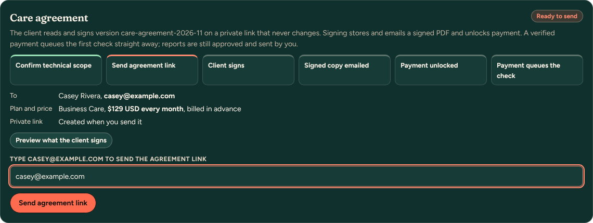

**The client receives:** an email titled “Your Website Care agreement for (website)” with the plan, price (“billed monthly in advance until you cancel”), included minutes and a **Read and Sign** button. Their page shows the agreement, then a typed name, a signature box and “I’ve read this agreement and agree to it”.

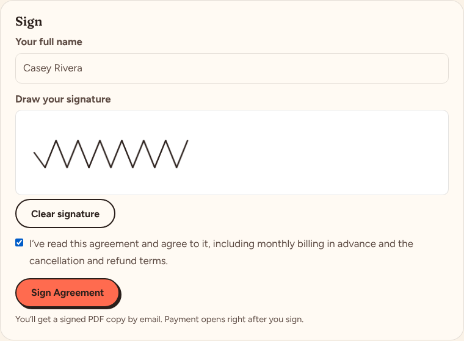

**When they sign:** the signature, name, time and address are stored with that exact version, a signed PDF is saved privately and emailed to the client (with the PDF attached) and to you. The panel shows **Signed, payment unlocked** and **Download signed PDF**.

**The agreement is blocked when the price doesn’t match.** Before an agreement is issued or payment opens, the app compares the plan’s configured Stripe price with the client’s agreed price. It refuses when the amount differs, the currency isn’t USD, it bills other than once a month, it is metered, tiered, archived or has a trial, it is a test price on a live account (or the reverse), or Stripe can’t be reached. The panel lists each problem. Fix the **Agreed monthly price** or the plan’s Stripe price.

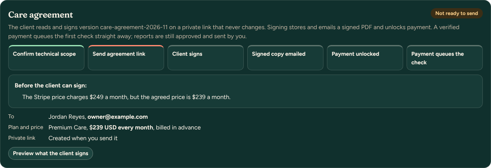

**Changes after signing:** changing the price, plan or checked scope locks payment (the open checkout link is closed) until a new version is sent and signed. A signed version is never altered; earlier versions are listed under **Earlier versions**. An existing subscriber without a signed current agreement is flagged **Agreement signature needed**; their earlier agreement stays in place until they sign.

### Turn a link off or replace it

Use this when the link went to the wrong address, a contact changed, or you just want a fresh link. In **Care agreement**, choose **Turn off or replace this link**, say **Why**, and tick **I understand the client’s current link stops working**.

- **Turn off only:** the old link stops working at once. The server refuses it for viewing, signing and payment (the client sees “This link is no longer active”, with nothing about the agreement). Any open Stripe checkout started from it is closed so it can’t be paid. Sending the agreement won’t create a new link by itself; choose **Issue a new link** when you’re ready.
- **Replace link:** the same as above, plus a new private link straight away. Then type the address and press **Send agreement link** (or **Send the new link** if they already signed).
- **Nothing is signed again because the link changed.** Signed agreements, their PDFs, signatures and the history belong to the website, not the link. A signed but unpaid client keeps payment unlocked on the new link; their email says the earlier link no longer works and nothing needs to be signed again.
- **Link history** lists every link (by its last characters only), when it was sent and to whom, when and why it was turned off, and which open checkout was closed.
- If the client had already completed a Stripe payment a moment before you turned the link off, Stripe can’t cancel it; the payment is handled as usual and appears under Subscription and billing.

### Payment unlocks

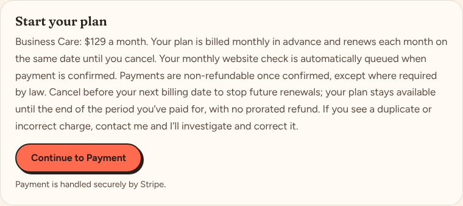

On their agreement page, the client chooses **Continue to Payment**. The app creates (or reuses) a Stripe Checkout for the verified price at that moment, so there is no invitation link to expire. **Copy payment link** in the panel gives you the same link after signing.

### The client pays

The client pays on Stripe’s page. Stripe’s verified payment notice then sets the billing to **Paid, active**, links the subscription, and creates the first monthly review.

**Automatic:** linking the subscription, **Paid through**, the current period, the first review with its included plan time, and the check: queued and the runner started straight from the payment notice. The review shows **Payment received**, **Scan queued** (runner started), **Running**, **Completed**, and you’re emailed when results are ready. If the runner can’t be started it retries (1, 5, 15, 60 minutes), then emails you once; **Retry start** tries again. If the scope isn’t confirmed, or care is paused or ended, the paid review is kept **On hold** and you’re emailed immediately.

**The client sees:** Stripe’s checkout page, then a “subscribed” page on your site. Stripe sends their receipt.

**Clients billed outside Stripe:** open **Billed outside Stripe? Add a paid service period by hand**. Enter the start and end, a note, tick **This period is paid or agreed in writing**, and press **Add service period**. The billing badge then says **Billed outside Stripe**.

**Fixing a mistake:** a paid period can’t be deleted from the app. If you added the wrong dates by hand, note it in the review and fix the next one.

**Demo:**
- **Lakeside Dental** has a ready made signed agreement: open it and press **Download signed PDF**, or find it under **Client documents**. You can also practice **Replace link** there.
- Stripe is simulated: the same checks and notices run, answered by a stand in. The agreement and signed copy emails appear in **Simulated actions**.
- Harbor Street Bakery shows a blocked price ($239 agreed, $249 Premium price).
- After sending the agreement link, **Practice billing events** has **Open the client’s agreement page (play the client)**: sign, then **Continue to Payment** opens the simulated checkout. With an open link it also has **Let the link expire**.
- **Create billing portal link** is acknowledged only.

## 3. Find the monthly review

**Review queue** lists each open review with its due time, client, work status, and billing.

The admin **Schedule** shows the same reviews under **Monthly care reviews**, and as diamonds on the calendar.

### Review history (every earlier month)

**Where:** each website’s page, **Review history**. From a client’s Pipeline profile, **Website Care: (website) (n reviews)** opens it. A client with several websites has one link and one history per website; the website page also lists **Other websites** for that client.

Each billing period shows, newest first (**Oldest first** reverses it):

- **Automated checks:** every check that period, when it ran and its result. **View results** opens that check’s stored results as they were (issues, screenshots while they are kept, then all results).
- **Findings:** issues and items not verified in the period’s latest check, how many have a decision, and how many you marked fixed.
- **Manual review:** how many checklist items were recorded, passed, need attention or weren’t checked.
- **Work recorded:** entries and minutes (included and additional), and any estimates with their status.
- **Report:** its status and version, when it was sent and to whom, **Sent PDF**, and under **Approved versions and sends** every approved version (including replaced ones) with its stored PDF.

**Open review** opens that month’s full review. In a review, **Runs, due date, and history** lists its checks; **View results** opens any of them.

**Agreement versions:** in **Care agreement**, **All agreement versions** lists every version issued for the website. **View** shows it as the client read it; **Signed PDF** downloads the stored signed copy.

**Demo:** Northside Physio has last month completed (check, manual review, work, approved and sent report) and this month in progress.

**Automatic:**
- A review is created for every paid period.
- The check runs as soon as the period starts.
- The review is due 7 days after the period starts (a working day, at the end of your workday; change it in **Settings**).
- Reminders go to you before the deadline and while overdue.

**Work status, in order:** **Scheduled**, **Check queued** or **Check running**, **Manual review due**, **Ready for approval**, **Approved, not sent**, **Report sent**. **Overdue** appears once the due time passes.

**Demo:** the check finishes instantly with fictional results, so a new review goes straight to **Manual review due**.

## 4. Automated findings and the manual checklist

**Issues found** groups failed results (for example **Page doesn’t fit the screen**). For each issue, choose **What happens next** and **Save**:

- **Fixed** (say how you verified it, or run the check again).
- **Needs client input**.
- **Needs approval for more work** (name the work; the estimate goes in Plan time).
- **I’m looking into it**.
- **Not an issue (hide from the report)**, which needs a private reason.

**Not verified** lists results the checker couldn’t confirm, such as a booking page that blocks robots. Those are said plainly in the report. **Passed** and **Screenshots** are there for reference.

**Manual checklist:** for each item, choose a **Result**, write **What you found (client sees this)**, and **Save**. **Not checked** and **Could not check** need a reason.

**Suggested wording in each field.** Under the client note, the verification, each manual note or reason, the work description and each estimate field, a **Suggested** line offers wording built from what you already chose. It never fills a field by itself: press **Use suggestion** (or **Replace my text with this** when you’ve written something). Suggestions never set a result, a decision or an approval, and never say work was done.
- A verification or manual note that says you **checked something by hand** shows **I checked this myself**. The button stays greyed out until you tick it, and the server refuses to save that exact wording without it. Write your own words instead if you did something different.
- When the latest automated check no longer finds an issue, the verification suggestion says **Rechecked automatically** with the date, and needs no tick.
- In **Plan time**, an estimate can start from an issue (**Suggest wording from an issue**). Minutes and price stay yours to enter.

**Run the check again** (in **Automated check**) reruns everything. An issue that is gone shows as **Cleared on recheck**.

**The client sees:** the issues in plain language, your decision and note, and the checklist results. Private notes never appear.

**Fixing a mistake:** change the choice and **Save** again. If the report was already approved, it goes back to draft.

**Demo:** the findings are fictional. The second agreed page is always reported too wide for phones, so there is something to handle.

## 5. Quick add work: presets, quantities, testing

**Where:** the review’s **Plan time and work** section (or the website’s page), **Quick add work**.

1. Under **Choose tasks**, tick presets. Proposed presets need **Confirm minutes** in the **Task catalog** first. **Add a custom task** for anything else.
2. Set the **Quantity** with **−** and **+**.
3. **Tested together with another task here** removes this line’s testing minutes when another line already covers the testing.
4. **Counts toward plan time**: **Yes**, or **No** for a covered defect correction, the monthly checks, or report preparation.
5. Check the summary: **Task minutes**, **Testing minutes**, **Standard minutes to apply**, **Available now**, **Available after recording**.
6. Set **Completed on**, tick **The work and its testing are complete.**, and press **Record completed work**.

**The rule:** quantity × task minutes, plus testing. Testing counts once per batch, or per unit for per unit tasks. Choosing a task deducts nothing; only **Record completed work** applies minutes. You can’t record more than is available; use an estimate instead.

## 6. Included, applied, reserved, and available minutes

- **Included**: the plan’s minutes for this billing period (Business 30, Premium 90, Essential none).
- **Applied**: standard minutes of completed work recorded this period.
- **Reserved**: minutes held for approved estimates not yet finished.
- **Available**: included, minus applied, minus reserved. Unused minutes don’t roll over.

Tick **All completed work for this period is recorded** when you’re done. Until then the report says the available time is **Not confirmed yet**.

**Fixing a mistake:** in **Recorded work**, choose **Correct** (records a corrected entry and returns the difference) or **Undo** (with a reason; the minutes come back). Both stay in the history, struck through.

**The client sees:** each task’s client facing description, plus the plan time used and available. They never see private notes or the calculation details.

## 7. Larger work: estimate, approval, completion, invoice

**Where:** **Plan time and work**, **New estimate**.

1. Fill in **Title**, **Scope**, **Expected deliverables**, **Agreed schedule**, **Total standard minutes, including testing**, and **Included minutes proposed**.
2. If there are additional minutes, enter the **Additional price ($)** and **How the price was calculated**:
   - **Use hourly wording**: $70 an hour with a one hour minimum (or a fixed quote you agree on).
   - **Use fixed quote wording**: an agreed fixed amount.
   - Standard minutes never set the price. You enter it.
3. **Save as draft**. A draft reserves nothing and appears in the report under “Waiting for your approval”.
4. When the client agrees, choose **Record client approval**, write how they approved, and press **Record client approval**. The included minutes are now **Reserved**.

5. When the work is done, press **Record work for this**. Add the task, tick **This finishes the estimate.** and the completion box, then **Record completed work**. The reservation is used first; the rest counts as approved additional work.
6. **Create invoice for $…**, then enter the invoice number and press **Save $… invoice**. A pending invoice is saved in **Revenue**. It isn’t sent and nothing is charged. Send it from Revenue as usual.

**Fixing a mistake:**
- **Edit** a draft.
- An approved estimate needs **Revise scope**; approving the revision replaces it.
- **Cancel** or **Declined** releases the reserved minutes.
- An invoice can only be created once per estimate.

**Demo:** real behavior. Client approval is recorded by you; there is no client approval link.

## 8. Report text, with suggested wording

The **Report text** section drafts the client wording for you from templates (no AI service, nothing paid). It uses only what is on record: the latest automated check, the manual results you saved, your **What happens next** decisions and client notes, the work ledger, and estimate statuses. **Private notes are never used.**

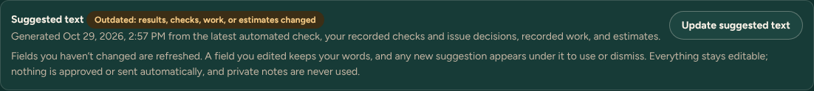

**When it runs**
- Automatically after a check finishes (succeeded or partly succeeded), while the report is still a draft.
- When you press **Update suggested text**. That button is greyed out while you have unsaved edits; save first.
- **Generated** shows when the suggestions were written. **Outdated: results, checks, work, or estimates changed** appears once any of those changes after that time. Press **Update suggested text** to refresh.

**Your edits are kept**
- A field you haven’t touched is refreshed in place.
- A field you edited keeps your words. The new wording appears under it as **Suggested replacement**, with **Use suggestion** and **Keep mine**. Each field is decided on its own.

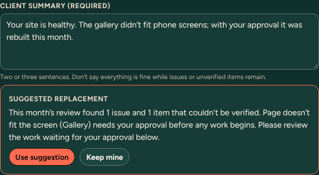

**The seven fields**

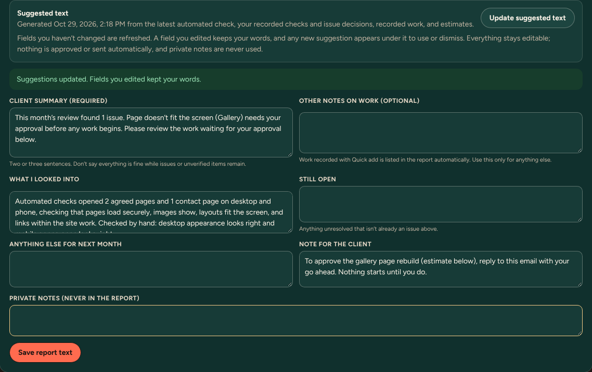

| Field | Shows in the report? | What the suggestion writes | What you should check |
| --- | --- | --- | --- |
| **Client summary (required)** | Yes, at the top and in the email | Two or three plain sentences: the overall result, any issue and its next step, and what you need from the client (or that nothing is needed). | It never says “fixed” unless a fix has a verification note, and never says everything passed while issues or unverified items remain. |
| **What I looked into** | Yes | The automated checks that actually ran (pages, linked pages, desktop and phone), then **Checked by hand:** the manual items you recorded. | Unrecorded or skipped manual items aren’t listed. If the check didn’t complete, nothing automated is claimed. |
| **Still open** | Yes | Left empty. Issues, unverified items, and approved work in progress already have their own sections, so nothing is repeated. | Add anything open that isn’t already in those sections. |
| **Anything else for next month** | Yes | Only follow ups the records support, for example an item that couldn’t be verified. No dates or promises. | Add a commitment only if you mean it. |
| **Other notes on work (optional)** | Yes | Left empty. Work from **Quick add work** is listed automatically. | Use only for work that isn’t in the ledger. |
| **Note for the client** | Yes | A specific request (approve an estimate, or send something you need), or nothing. | Leave it blank when there’s nothing to ask. |
| **Private notes (never in the report)** | No | Never filled, and never read by the suggestions. | Your own notes. |

**Approval and sending stay with you.** Suggestions never approve or send anything. Applying a suggestion to an approved report returns it to draft, so it needs approval again. A sent version is never changed.

**Demo:** real behavior. Open Rivera Garden Design’s review, run the check, and watch the fields fill in.

## 9. Preview, approve, and send the report

1. **Report text**: check the suggestions (section 8), make sure the **Client summary** is right, and press **Save report text**. Recorded work is listed automatically.
2. **Preview and approve**: if **Before this can be marked ready** lists anything, fix it. Then press **Mark ready for review**.
3. Open **Client report preview**, **Open PDF preview**, or **Download preview PDF**.
4. Tick the sign off, type **Your name**, and press **Approve this version**.

5. **Send**: check **Sending to**, the **Subject**, and the **Message**. Type the recipient address to confirm, then press **Send Report**.

6. The badge shows the delivery state: **Accepted by provider, delivery not confirmed** means Resend took the message. **Delivered** shows only if Resend’s signed delivery webhook is set up. Acceptance completes the review and its calendar item.

**The client receives** one email:
- **Subject and message:** what you typed on the send screen (the default greets them by first name and says what the report covers).
- **The complete approved report**, in the same order as the PDF: the month and website; your plan with included and used time; the headline and the Passed, Issues found, and Not verified counts; **Your next step**; the **Client summary**; **Needs attention** (what’s wrong, why it matters, where, and what happens next); **Fixed and verified**; **This month’s checks**; **Not verified this month**; **Work completed** (recorded work, **Other notes on work**, **What I looked into**, **Still open**); **Waiting for your approval** with each estimate’s minutes and price; approved work in progress; the **Note for the client**; and the note that automated checks aren’t a certification.
- **The approved PDF attached** (“Health report (website) (month).pdf”), with a line naming its version.

Both come from the frozen copy made when you approved, so the email and the PDF always say the same thing. **Private notes** are never in either.

**Fixing a mistake:**
- Editing after approval returns the report to draft.
- After sending, an edit creates a new version. The sent version is kept exactly as sent.
- Resend a report with **Send** after approving the new version.

**Demo:** the email is simulated. Look in **Simulated actions** in the demo bar for it, with its text.

## 10. Renewal, failed payment, cancellation, unfinished work

**Implemented (Stripe clients)**

- **Renewal:** each paid renewal creates the next review automatically, updates **Paid through**, and runs the check.
- **Failed payment:** the website shows **Past due** (or **Payment failed**), the failed payment count goes up, it counts under **Billing attention**, and you get an email. Stripe retries on its own schedule. No review starts for an unpaid period. Once the problem is handled, **Mark billing reviewed** with a note.
- **Client cancels at period end:** shows **Canceling at period end**. The paid period is still honored and no new review starts after it.
- **Canceled immediately:** open reviews are flagged **canceled immediately** for your decision. Past reports are kept.
- **Refund or dispute:** the website and that period are flagged (**Refund recorded** or **Disputed**) for your review.

**Clients billed outside Stripe:** there is no automatic renewal. Add each paid period by hand.

**Unfinished reservation:** an approved estimate near or past its period end is flagged on the Overview (**Unfinished approved work**). Reserved minutes never carry into the next period. **Carry to current period** creates a new draft that needs approval again; **Cancel** releases the minutes.

**Approved (Oct 29, 2026)** (**Settings, Billing policy: approved**, read only): billed monthly in advance; payment queues the check; non-refundable after payment except where required by law; cancel future renewals before the next billing date, effective at the end of the paid period with no prorated refund; duplicate or incorrect charges always corrected; paid periods that can't be served are flagged. The client signs this in the care agreement.

**Awaiting your decision** (**Settings, Billing policy: still to decide**):
- The grace period.
- What to do about disputes.
- How many failed payments raise billing attention.

Today these settings only control flags and reminder emails; nothing is suspended or refunded automatically, and live checkout stays off. Record your approval with **Record approval**.

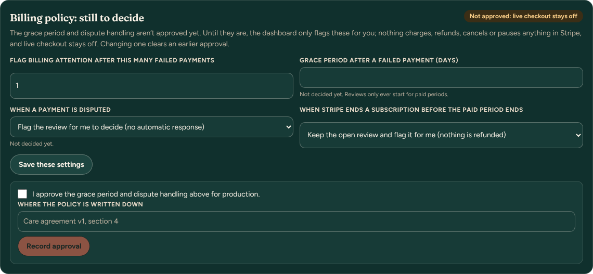

**Repeated notices are safe.** Stripe can send the same notice more than once. Each notice is recorded by its id and processed once, and each paid invoice and each period can only create one review, so a repeat never adds a second period, review, or allowance of included minutes.

### Practice them in the demo

Open **Lakeside Dental** (it has a simulated subscription). Under **Subscription and billing**, **Practice billing events (demo)** has:

| Button | What happens | What to look for |
| --- | --- | --- |
| **Renewal** | The next month is paid. | A new period in **Review history**, **Paid through** moves a month. |
| **Failed payment** | The renewal payment fails. Press again for another failed attempt. | **Past due**, the failed payment count, **Billing attention** on the Overview, and an owner email in **Simulated actions**. No new review. |
| **Renewal** (after a failure) | Stripe’s retry succeeds. | Back to **Paid, active**; that month’s review appears once. Then **Mark billing reviewed**. |
| **Cancel at period end** | The client schedules cancellation. | **Canceling at period end**. The paid period continues. |
| **Renewal** (after scheduling cancellation) | The period ends instead of renewing. | **Canceled**; no new review. |
| **Cancel immediately** | The subscription ends now. | **Canceled**, and the open review is flagged **canceled immediately** for your decision. |
| **Send the last notice again** | Stripe redelivers the same notice. | Each notice is listed as “already processed, ignored”. Nothing is added. |

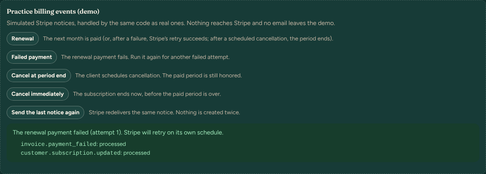

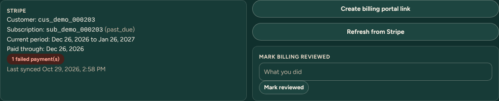

Each button changes the simulated subscription the way Stripe would and runs Stripe’s notices through the same processing as real webhooks. Use **Reset demo** to start over (for example, to try **Cancel immediately** after practicing the others).

## 11. Projects: pricing, proposals, contracts, and payments

These steps are outside Website Care but use the same rates. Everything is in the admin **Documents** and **Pipeline** pages.

### Your rates and payment terms

- **Standard rate:** $70 an hour with a one hour minimum, or a fixed quote you agree on. New proposals, statements of work, contracts, estimates, and care terms all use it. It lives in one place in the code (`src/lib/terms.ts`), so changing it later is one edit.
- **Project payments:** a 50% deposit is due before work begins. The remaining 50% is divided across the project milestones listed in the proposal and agreement. You choose the milestones; nothing is split for you.
- **Agreed rates are kept.** A document can carry a different hourly rate you agreed with that client. Documents issued earlier keep their exact wording, rate, and payment plan (they are stamped with the terms version they were issued under).
- **Monthly care prices and included minutes are unchanged.** Care minutes measure time; they never become a dollar charge on their own.

### My Pricing cards

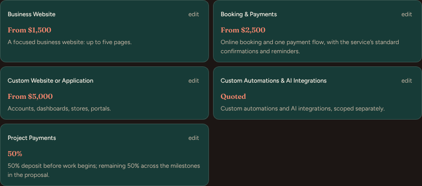

The cards are **Business Website**, **Booking & Payments**, **Custom Website or Application**, **Custom Automations & AI Integrations**, and **Project Payments**. Press **edit** on a card to change its price or description; your edits are kept.

**Booking & Payments versus automations.** Booking & Payments already includes the booking service’s standard confirmations and reminders. If a proposal for it has a priced line for confirmation or reminder emails, the form warns you so the client isn’t charged twice. Custom automations and AI integrations (a CRM, a workflow tool, an AI step) are scoped and priced separately under their own card.

### 1. Write a proposal with a payment schedule

1. **Documents, Fill out Proposal.** Fill in the client, project, type, and line items.
2. **Timeline and additional work:** the **Hourly rate for additional work** starts at $70. Change it only if you agreed a different rate.
3. **Payment schedule:** the deposit (50%) is calculated from the total. Add a milestone for each payment of the remaining 50%: a **name**, the **deliverable or payment trigger** (what has to happen before you invoice it), an **amount**, and an optional **target date**. **+ Add milestone** adds another.
4. Watch the fourth box. **Still to assign** means the milestones don’t yet add up to the remaining 50%; the message underneath says by how much.

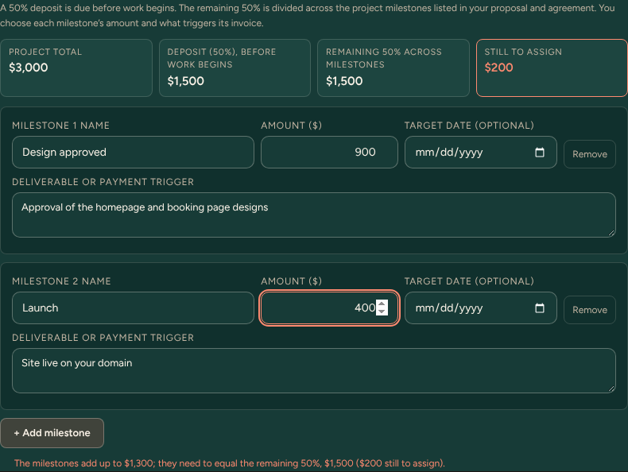

5. When it reads **All assigned, $0**, the schedule balances to the cent. The proposal can’t be sent until it does (the server checks again).

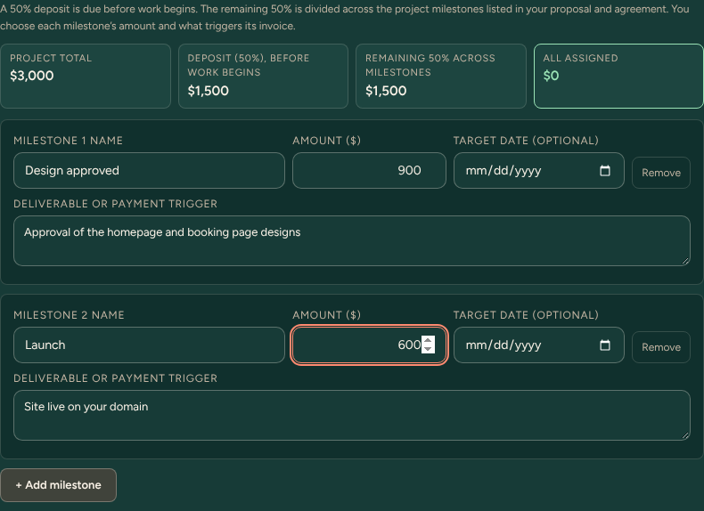

**The client sees** the deposit and each milestone with its trigger and date, in the proposal page, its email, and its PDF.

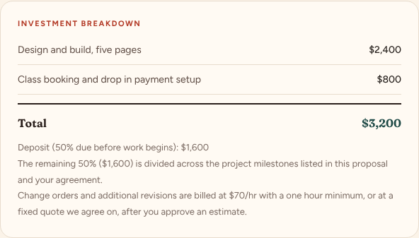

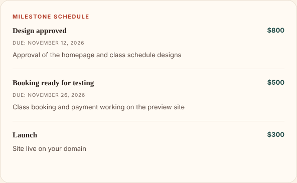

### 2. Send the contract

1. **Documents, Fill out contract.** Choose the accepted proposal under **Select from accepted proposals**. The client, total, rate, and milestones fill in from it; you can adjust them.
2. Check the **Payment** section: total fee, hourly rate, kill fee, payment method, and the schedule (it must say **All assigned**). The line under it shows which Pipeline client the invoice schedule will be linked to.
3. **Deposit invoice:** the invoice number and due date for the deposit.
4. **Legal terms included** lists the clauses the client signs, including the payment and rate clauses.
5. **Preview**, then **Send for Signature**.

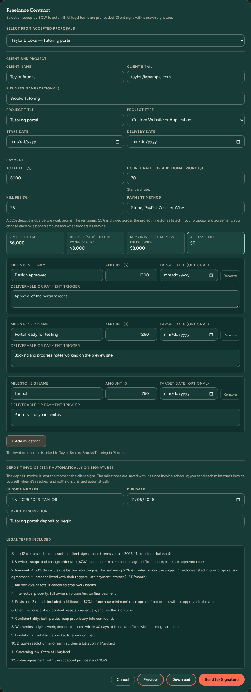

**The client sees** the payment summary on the contract page: the deposit, the remaining 50%, each milestone, the payment method, and the kill fee. They sign with a drawn signature and their typed name.

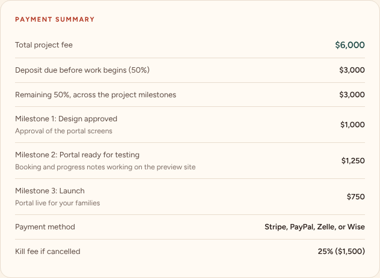

### 3. After signing: the invoice schedule

- Signing creates **one** invoice schedule for the contract: the deposit first, then each milestone. A contract can only ever have one, so milestone invoices can’t be duplicated.
- The deposit invoice is emailed when the client signs.
- **Nothing is charged automatically.** Each milestone stays **Not invoiced** until you press **Send invoice** in Pipeline. Sending one that was already sent asks first and goes as a reminder (**Resend reminder**).
- Record payments yourself with **Record payment**. When the deposit is paid the schedule shows deposit paid; when every payment is in, it shows paid in full.

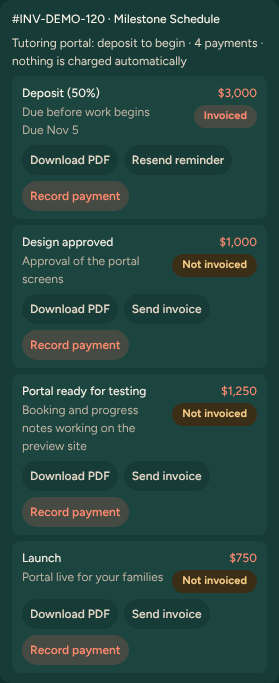

**Revenue** lists the schedule as one row (marked **(ms)**). **dep** records the deposit and **next** records the next unpaid milestone; to pick a specific one, use Pipeline.

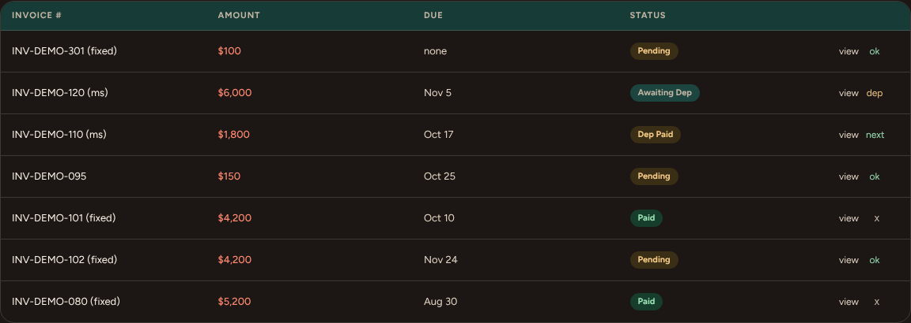

**Demo:** real behavior with simulated email and payments. The sample proposal is Ellis Yoga Studio’s, and Taylor Brooks’s contract can be signed as the client from its link.

## Client documents

**Where:** the client’s profile in **Pipeline** (Documents), and **Client documents** on each of their websites in Website Care. Both show the same list, found by the client’s record, never by name or email.

It lists, newest first: uploaded files, proposals, statements of work, contracts, invoices (with how many milestone payments are in), signed care agreements (with **Download signed PDF**, the stored file) and sent care reports (with their PDF). **Open client profile in Pipeline** and **Website Care: (website)** move between the two.

**Possibly this client’s, not linked** collects older records that only match the client’s email (for example a proposal sent before it was linked to a client record). They aren’t counted as the client’s. Open each one and check it; nothing is merged automatically.

## Less frequent tasks

- **Pause or end care:** on the website’s page, **Pause reviews** / **Resume reviews**, or **End care for this website** (reports are kept).
- **Change pages or checklist:** **Website settings**, **Save changes**, then confirm the setup again.
- **Move a due date:** in the review, **Runs, due date, and history**, then **Change due date**.
- **Retry a failed email to you:** Overview, **Needs your attention**, **Retry now**.
- **A send that never finished:** check the Resend log first, then **Mark not sent** and send again.
- **Review an older agreement:** Overview flag **Agreement predates flexible plan time**, then **Review**. Fill in how they accepted the current terms and press **Mark agreement reviewed**.
- **Add or change a preset:** **Task catalog**. Editing minutes makes it proposed again until you **Confirm minutes**.

## Troubleshooting

| What you see | What it means | What to do |
| --- | --- | --- |
| **Confirm setup** says the address is “private or reserved” | The address resolves to a private network, or it isn’t public. | Check the address and approved domains. Use **Check**. |
| Review shows **Paid, on hold** | A paid period arrived while the scope wasn’t confirmed, or care was paused or ended. | Confirm the technical scope, or resume care. An ended site’s payment is for you to decide. |
| **The check couldn’t start** | The runner dispatch failed 5 times. | Check the GitHub dispatch settings, then **Retry start** on the review. |
| **Check failed: retry needed** | The checker couldn’t finish after its retries. | **Run the check again**; read the error under **Runs, due date, and history**. |
| **Not ready to send** or **Checkout is blocked** | The scope isn’t confirmed, a required check is missing, or the plan’s Stripe price doesn’t match the agreed price, currency, or monthly billing. | Read the listed problems and fix each one. Retry if Stripe was unreachable. |
| “The agreement link was already sent” | The same private link was already emailed. | Use **Send again** to send a reminder. |
| **Signature needed for the current details** | The price, plan or scope changed after signing. | **Send updated agreement**; payment opens once they sign it. |
| **Quick add work** is greyed out | The client’s care terms aren’t current. | Record the terms (setup confirmation or **Mark agreement reviewed**). |
| Plan time says **No paid billing period yet** | There’s no paid period for this website. | Wait for the first payment, or add a paid period by hand. |
| “needs X standard minutes but only Y are available” | Recording would go past the allowance. | Create an estimate for the larger work. |
| **Mark ready for review** is greyed out | Something required is missing. | Fix each item listed under **Before this can be marked ready**. |
| **Send Report** is greyed out | The typed address doesn’t match, or client emails are switched off here. | Type the exact recipient address. In preview, client emails are limited to the test allowlist (simulated in the demo). |
| Delivery says **Not confirmed** | Resend’s delivery webhook isn’t set up. | Normal. Check the Resend dashboard if you need proof of delivery. |
| **Billing attention** above 0 | A payment failed, or a refund or dispute arrived. | Handle it in Stripe, then **Mark billing reviewed**. |
| Demo shows an error | The demo session’s data is odd, or the server was idle. | Wait a few seconds and retry, or **Reset demo**. |

## Labels and statuses that could confuse

- **Next review due “Not set” on the Websites table, while the queue shows due dates.** This was a bug, not two different meanings. The column read a stored date that was written only when a period was created. The demo’s sample websites didn’t have it, and it also went stale after a report was sent. It is now taken from the earliest open review, the same one the queue shows. Blank cells now say **After setup and first payment** or **Waits for the next paid period**.
- **“No subscription yet” for clients you bill by hand.** That was the Stripe state, which looked like the client hadn’t paid. Websites with paid periods added by hand now show **Billed outside Stripe**.
- **Care terms were stamped as accepted on saving.** Fixed: acceptance is now recorded when you confirm the setup, with your own note of how the client accepted.
- **Three billing words.**
  - **Period paid** (in a review’s header): this period is paid.
  - **Paid, active** (on the website): the Stripe subscription is in good standing.
  - **Paid** or **Billed outside Stripe** (in the queue): how the period was paid.
  - They don’t say whether the review is done; the work status does.
- **Agreed monthly price versus the Stripe charge.** Fixed: the agreement and checkout are blocked unless the plan’s Stripe price charges exactly the agreed price, in USD, monthly. A client with a custom price can’t check out until a matching Stripe price exists for that plan, or you bill them by hand. Per client Stripe prices aren’t built.
- **“(no Stripe price set)” beside a plan.** The Stripe price ID for that plan isn’t configured, so checkout would fail. The demo hides this because checkout there is simulated.
- **“Accepted by provider” is not “Delivered”.** Delivery is confirmed only with Resend’s webhook.
- **Revenue shorthand.** **(ms)** is a milestone schedule, **(fixed)** a fixed fee invoice, **(rev)** a revision invoice. **Awaiting Dep** means the deposit is invoiced but not paid; **Dep Paid** means the deposit is in and milestones remain.
- **Milestone “Invoiced” is not “Paid”.** Invoiced only means the email went out.
- **Billing policy “proposed”.** These settings flag and remind; they don’t enforce anything yet.

Fixed while writing this guide: confirming a real website’s setup failed for every public IPv4 address (the private address check matched IPv4 against an IPv6 rule). Every new enrollment would have been refused at **Confirm setup and enable reviews**. After the fix, a new enrollment was run through setup confirmation locally with the real address lookup: a public address (IPv4 and IPv6) was confirmed, and a private address was refused. To check one of your own domains against real DNS, run `node scripts/check-care-address.mjs https://www.yourdomain.com/ yourdomain.com`. It only looks the name up; it writes and sends nothing.
