# Website Care owner’s guide

How to run Website Care day to day, using the screens and buttons as they are built. Open it from **Website Care, Help / Owner’s guide**, or read it on GitHub. The screenshots come from the preview demo (fictional data, simulated services). The technical reference is [WEBSITE_CARE.md](WEBSITE_CARE.md); how the demo works is in [ADMIN_DEMO.md](ADMIN_DEMO.md).

> Each step says what is **simulated in the demo** and what is **not implemented yet**. Nothing in the demo reaches Stripe, Resend, Zoom, the check runner, or the real database.

## Map of the Website Care area

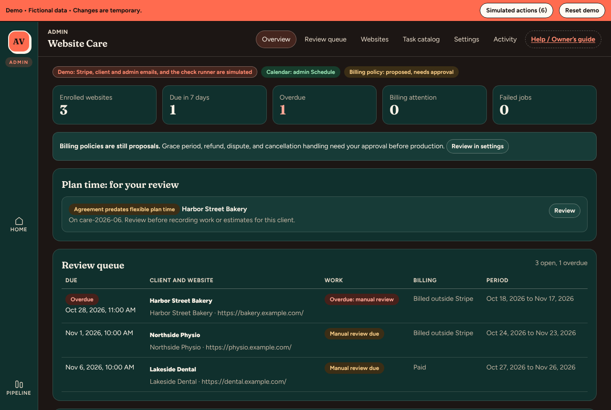

| Tab | What it’s for | How often |
| --- | --- | --- |
| **Overview** | Counts (enrolled, due in 7 days, overdue, billing attention, failed jobs), the “Plan time: for your review” flags, anything that needs attention, the review queue, and the websites table. Start here. | Every working day |
| **Review queue** | Only the open monthly reviews, earliest due first, with work status and billing. Click a row to open the review. | Every working day |
| **Websites** | Every enrolled website. **Enroll a website** starts a new one. A website’s page has its setup, billing, monthly reviews, plan time, settings, and history. | Weekly, and when a client joins or changes |
| **Task catalog** | The standard minutes for common tasks. Confirm a preset’s minutes once before Quick add can use it. | Setup, then when you add or change a task |
| **Settings** | Time zone, workday, review deadline and reminders, screenshot retention, and the billing policy (still a proposal). | Setup only |
| **Activity** | A log of every change (who, what, when). For checking what happened. | Only when you need it |
| **Help / Owner’s guide** | This guide, with a search box. | When you need it |

The admin **Schedule** page also shows each review’s due date (a green diamond), next to discovery calls. Reviews never block booking times.

## Your monthly checklist

1. Open **Website Care, Overview**. Deal with anything in **Needs your attention** and **Plan time: for your review**.
2. Open each review in the **Review queue**, overdue ones first.
3. In **Issues found**, choose **What happens next** for every issue and **Save**.
4. In **Manual checklist**, choose a **Result** for every item and **Save** each one.
5. In **Plan time and work**, record any finished work with **Quick add work**. Tick **All completed work for this period is recorded** when the period’s work is in.
6. In **Report text**, write the **Client summary** and **Save report text**.
7. In **Preview and approve**: **Mark ready for review**, open the preview or PDF, tick the sign off, type your name, **Approve this version**.
8. In **Send**: type the recipient address to confirm, **Send Report**. Check the badge says **Accepted by provider**.
9. Look at **Billing attention** on the Overview. Reply to any payment problems in Stripe.
10. For clients billed outside Stripe, add next month’s paid period by hand (see the reference below).

## 1. Enroll a website and record the care terms

**Where:** **Websites** (or the Overview), **Enroll a website**.

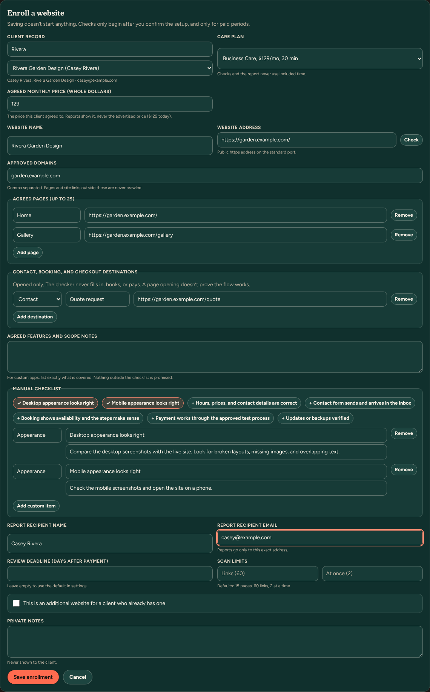

**What you enter**

- **Client record**: search, then choose the existing client. Care links to this exact record, never by email.
- **Care plan**: Essential, Business, or Premium.
- **Agreed monthly price**: what this client agreed to pay. Reports show this figure.
- **Website name**, **Website address** (public https), and **Approved domains**. **Check** tests that the address is public and inside the approved domains.
- **Agreed pages**, plus any **Contact, booking, and checkout destinations**. Destinations are opened only; nothing is filled in, booked, or paid.
- **Manual checklist**: tap the suggested items, or **Add custom item**.
- **Report recipient name** and **email**. Reports go only to this exact address.
- **Save enrollment**.

**What happens after saving:** the website is a draft (**Needs confirmation**). Nothing is checked or billed. Its page opens with **Confirm the setup**.

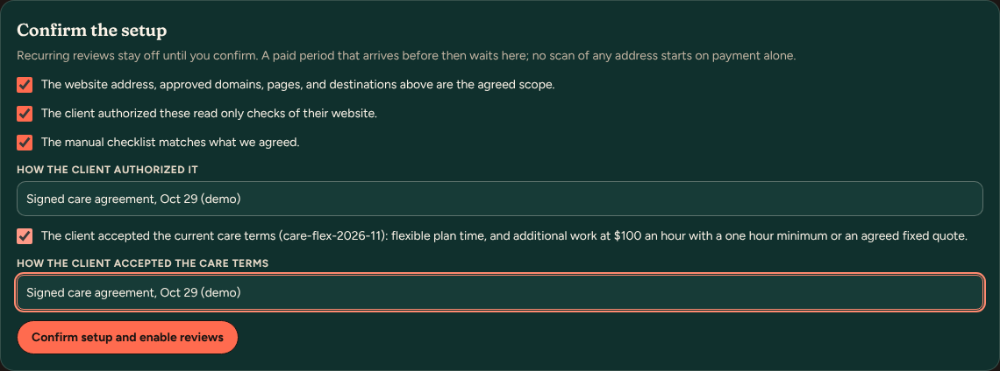

**Confirm the setup:** tick the three scope boxes, fill in **How the client authorized it**, then tick **The client accepted the current care terms** and fill in **How the client accepted the care terms**. Then press **Confirm setup and enable reviews**. The header then says **Setup confirmed**. The header’s **Care terms** line shows the version and your note.

**Automatic:** the address is checked again (it must be public). Any paid period that was waiting for confirmation starts.

**The client sees:** nothing. Enrollment and confirmation are internal.

**Fixing a mistake:** edit **Website settings** further down the website’s page and **Save changes**. If you change what gets checked, reviews pause until you confirm the setup again. Use **End care for this website** to remove one; its reports are kept.

**Demo:** real behavior, run on the demo data. The address check is answered without looking up the real domain.

## 2. Subscription, checkout, and payment status

**Where:** the website’s page, **Subscription and billing**.

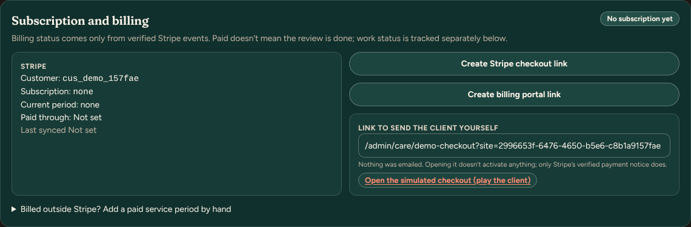

1. **Create Stripe checkout link**. A link appears under **Link to send the client yourself**.
2. Copy it and send it to the client in your own email. **The app doesn’t email a subscription invitation**; that isn’t implemented.
3. The client pays on Stripe’s page. Stripe’s verified payment notice then sets the billing to **Paid, active** and creates the first monthly review.

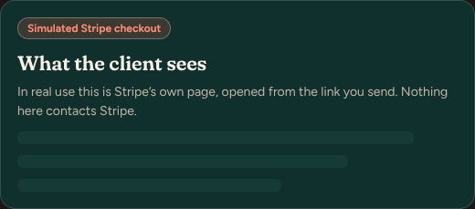

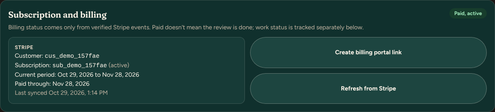

**Automatic:** linking the subscription, **Paid through**, the current period, the first review, the check, and an email to you saying the review is ready.

**You:** create and send the link. Opening the link doesn’t activate anything.

**The client sees:** Stripe’s checkout page, then a “subscribed” page on your site. Stripe sends their receipt.

**The price charged:** Stripe charges the plan’s Stripe price ($59, $129, or $249). If the **Agreed monthly price** is different, Stripe still charges the plan price. A custom price needs its own Stripe price; that isn’t built yet.

**Clients billed outside Stripe:** open **Billed outside Stripe? Add a paid service period by hand**. Enter the start and end, a note, tick **This period is paid or agreed in writing**, and press **Add service period**. The billing badge then says **Billed outside Stripe**.

**Fixing a mistake:** a paid period can’t be deleted from the app. If you added the wrong dates by hand, note it in the review and fix the next one.

**Demo:**
- **Open the simulated checkout (play the client)** stands in for Stripe’s page. **Pay (simulated)** plays Stripe’s payment notice.
- **Create billing portal link** and **Refresh from Stripe** are acknowledged only.

## 3. Find the monthly review

**Review queue** lists each open review with its due time, client, work status, and billing.

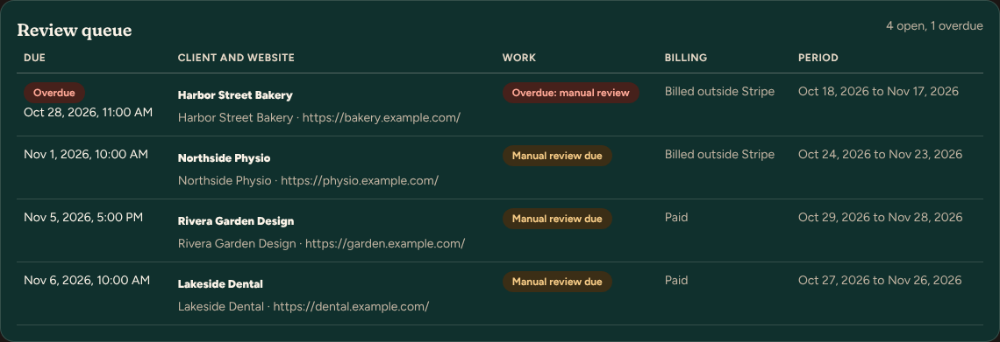

The admin **Schedule** shows the same reviews under **Monthly care reviews**, and as diamonds on the calendar.

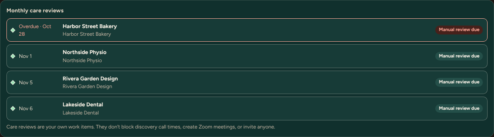

**Automatic:**
- A review is created for every paid period.
- The check runs as soon as the period starts.
- The review is due 7 days after the period starts (a working day, at the end of your workday; change it in **Settings**).
- Reminders go to you before the deadline and while overdue.

**Work status, in order:** **Scheduled**, **Check queued** or **Check running**, **Manual review due**, **Ready for approval**, **Approved, not sent**, **Report sent**. **Overdue** appears once the due time passes.

**Demo:** the check finishes instantly with fictional results, so a new review goes straight to **Manual review due**.

## 4. Automated findings and the manual checklist

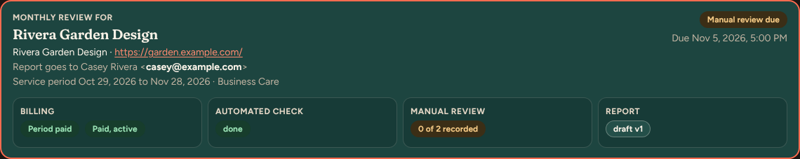

**Issues found** groups failed results (for example **Page doesn’t fit the screen**). For each issue, choose **What happens next** and **Save**:

- **Fixed** (say how you verified it, or run the check again).
- **Needs client input**.
- **Needs approval for more work** (name the work; the estimate goes in Plan time).
- **I’m looking into it**.
- **Not an issue (hide from the report)**, which needs a private reason.

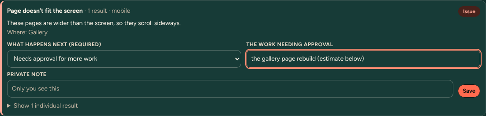

**Not verified** lists results the checker couldn’t confirm, such as a booking page that blocks robots. Those are said plainly in the report. **Passed** and **Screenshots** are there for reference.

**Manual checklist:** for each item, choose a **Result**, write **What you found (client sees this)**, and **Save**. **Not checked** and **Could not check** need a reason.

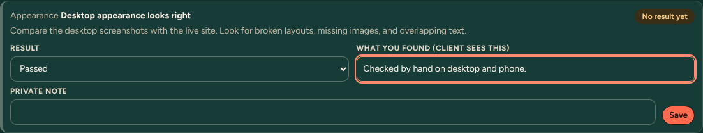

**Run the check again** (in **Automated check**) reruns everything. An issue that is gone shows as **Cleared on recheck**.

**The client sees:** the issues in plain language, your decision and note, and the checklist results. Private notes never appear.

**Fixing a mistake:** change the choice and **Save** again. If the report was already approved, it goes back to draft.

**Demo:** the findings are fictional. The second agreed page is always reported too wide for phones, so there is something to handle.

## 5. Quick add work: presets, quantities, testing

**Where:** the review’s **Plan time and work** section (or the website’s page), **Quick add work**.

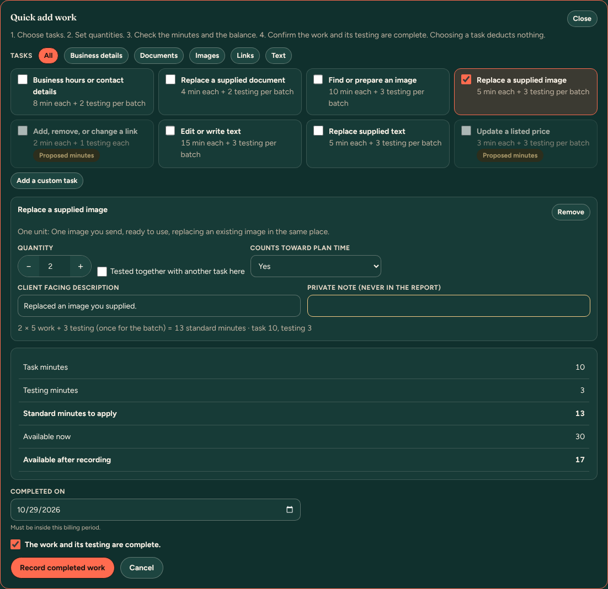

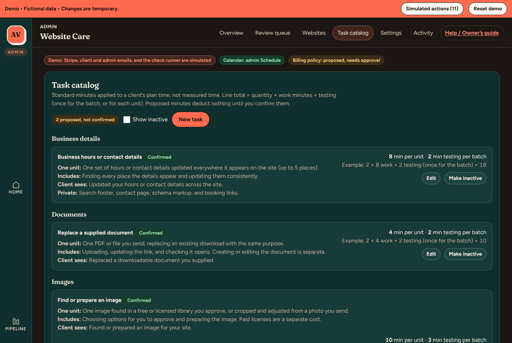

1. Under **Choose tasks**, tick presets. Proposed presets need **Confirm minutes** in the **Task catalog** first. **Add a custom task** for anything else.
2. Set the **Quantity** with **−** and **+**.
3. **Tested together with another task here** removes this line’s testing minutes when another line already covers the testing.
4. **Counts toward plan time**: **Yes**, or **No** for a covered defect correction, the monthly checks, or report preparation.
5. Check the summary: **Task minutes**, **Testing minutes**, **Standard minutes to apply**, **Available now**, **Available after recording**.
6. Set **Completed on**, tick **The work and its testing are complete.**, and press **Record completed work**.

**The rule:** quantity × task minutes, plus testing. Testing counts once per batch, or per unit for per unit tasks. Choosing a task deducts nothing; only **Record completed work** applies minutes. You can’t record more than is available; use an estimate instead.

## 6. Included, applied, reserved, and available minutes

- **Included**: the plan’s minutes for this billing period (Business 30, Premium 90, Essential none).
- **Applied**: standard minutes of completed work recorded this period.
- **Reserved**: minutes held for approved estimates not yet finished.
- **Available**: included, minus applied, minus reserved. Unused minutes don’t roll over.

Tick **All completed work for this period is recorded** when you’re done. Until then the report says the available time is **Not confirmed yet**.

**Fixing a mistake:** in **Recorded work**, choose **Correct** (records a corrected entry and returns the difference) or **Undo** (with a reason; the minutes come back). Both stay in the history, struck through.

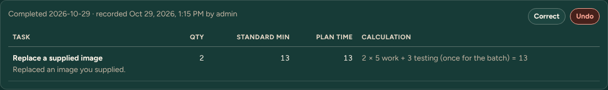

**The client sees:** each task’s client facing description, plus the plan time used and available. They never see private notes or the calculation details.

## 7. Larger work: estimate, approval, completion, invoice

**Where:** **Plan time and work**, **New estimate**.

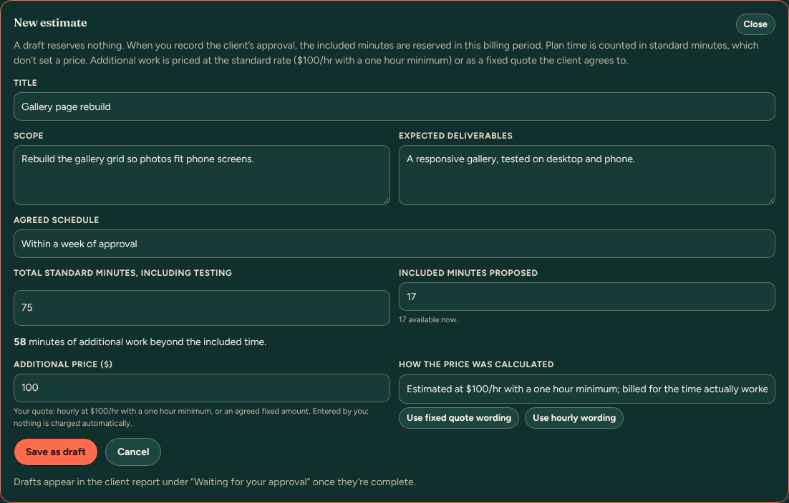

1. Fill in **Title**, **Scope**, **Expected deliverables**, **Agreed schedule**, **Total standard minutes, including testing**, and **Included minutes proposed**.
2. If there are additional minutes, enter the **Additional price ($)** and **How the price was calculated**:
   - **Use hourly wording**: $100 an hour with a one hour minimum.
   - **Use fixed quote wording**: an agreed fixed amount.
   - Standard minutes never set the price. You enter it.
3. **Save as draft**. A draft reserves nothing and appears in the report under “Waiting for your approval”.
4. When the client agrees, choose **Record client approval**, write how they approved, and press **Record client approval**. The included minutes are now **Reserved**.

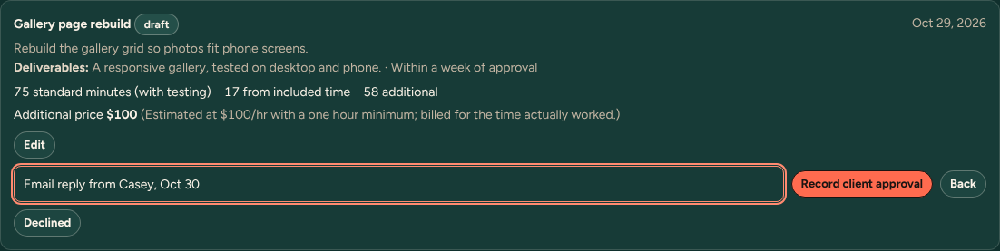

5. When the work is done, press **Record work for this**. Add the task, tick **This finishes the estimate.** and the completion box, then **Record completed work**. The reservation is used first; the rest counts as approved additional work.
6. **Create invoice for $…**, then enter the invoice number and press **Save $… invoice**. A pending invoice is saved in **Revenue**. It isn’t sent and nothing is charged. Send it from Revenue as usual.

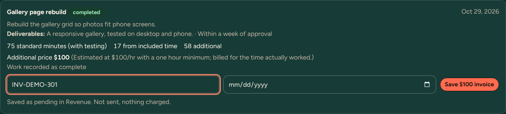

**Fixing a mistake:**
- **Edit** a draft.
- An approved estimate needs **Revise scope**; approving the revision replaces it.
- **Cancel** or **Declined** releases the reserved minutes.
- An invoice can only be created once per estimate.

**Demo:** real behavior. Client approval is recorded by you; there is no client approval link.

## 8. Preview, approve, and send the report

1. **Report text**: write the **Client summary** (required) and press **Save report text**. Recorded work is listed automatically.
2. **Preview and approve**: if **Before this can be marked ready** lists anything, fix it. Then press **Mark ready for review**.
3. Open **Client report preview**, **Open PDF preview**, or **Download preview PDF**.
4. Tick the sign off, type **Your name**, and press **Approve this version**.

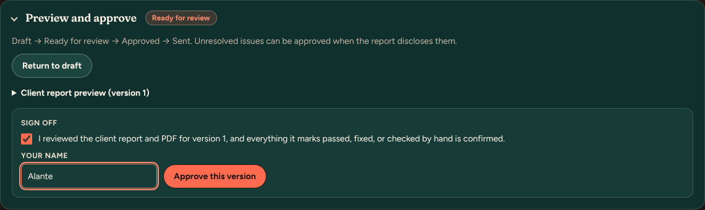

5. **Send**: check **Sending to**, the **Subject**, and the **Message**. Type the recipient address to confirm, then press **Send Report**.

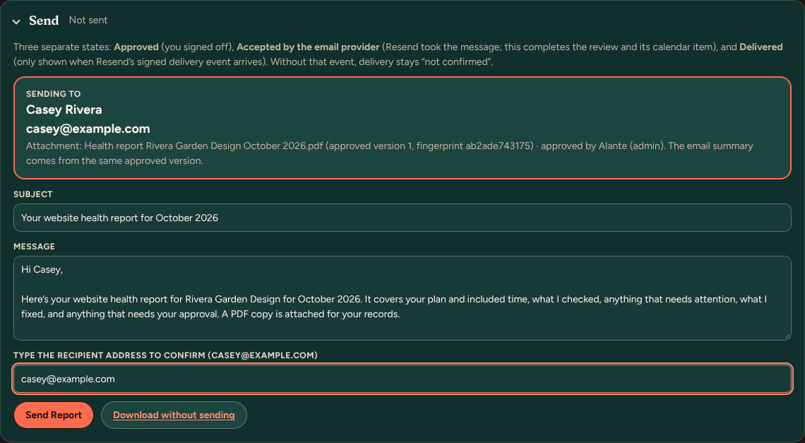

6. The badge shows the delivery state: **Accepted by provider, delivery not confirmed** means Resend took the message. **Delivered** shows only if Resend’s signed delivery webhook is set up. Acceptance completes the review and its calendar item.

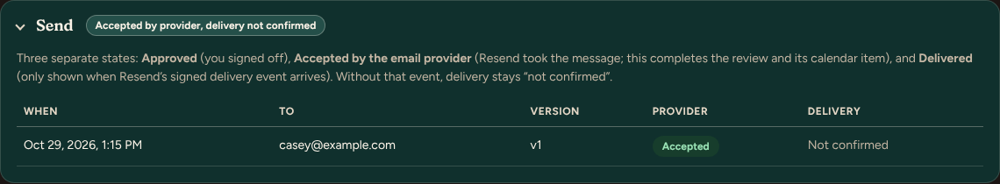

**The client receives:** an email with the report summary and the approved PDF attached.

**Fixing a mistake:**
- Editing after approval returns the report to draft.
- After sending, an edit creates a new version. The sent version is kept exactly as sent.
- Resend a report with **Send** after approving the new version.

**Demo:** the email is simulated. Look in **Simulated actions** in the demo bar for it, with its text.

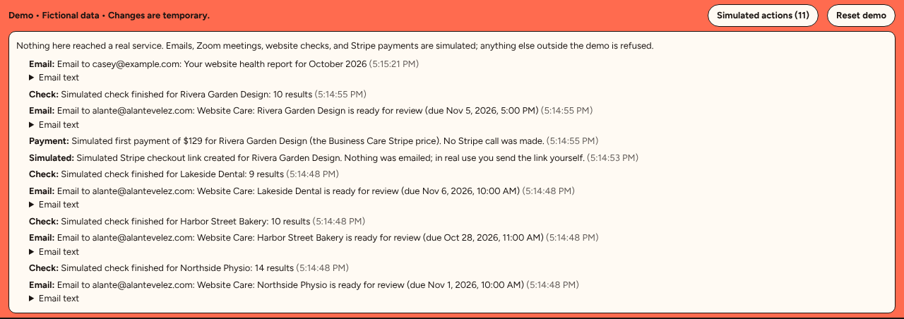

## 9. Renewal, failed payment, cancellation, unfinished work

**Implemented (Stripe clients)**

- **Renewal:** each paid renewal creates the next review automatically, updates **Paid through**, and runs the check.
- **Failed payment:** the website shows **Payment failed** and counts under **Billing attention**, and you get an email. Stripe retries on its own schedule. No review starts for an unpaid period. Once the problem is handled, **Mark billing reviewed** with a note.
- **Client cancels at period end:** shows **Canceling at period end**. The paid period is still honored and no new review starts after it.
- **Canceled immediately:** open reviews are flagged **canceled immediately** for your decision. Past reports are kept.
- **Refund or dispute:** the website and that period are flagged (**Refund recorded** or **Disputed**) for your review.

**Clients billed outside Stripe:** there is no automatic renewal. Add each paid period by hand.

**Unfinished reservation:** an approved estimate near or past its period end is flagged on the Overview (**Unfinished approved work**). Reserved minutes never carry into the next period. **Carry to current period** creates a new draft that needs approval again; **Cancel** releases the minutes.

**Awaiting your decision** (**Settings, Billing policy (proposed)**):
- The grace period.
- What to do about refunds, disputes, and immediate cancellations.
- How many failed payments raise billing attention.

Today these settings only control flags and reminder emails; nothing is suspended or refunded automatically. Record your approval with **Record approval**.

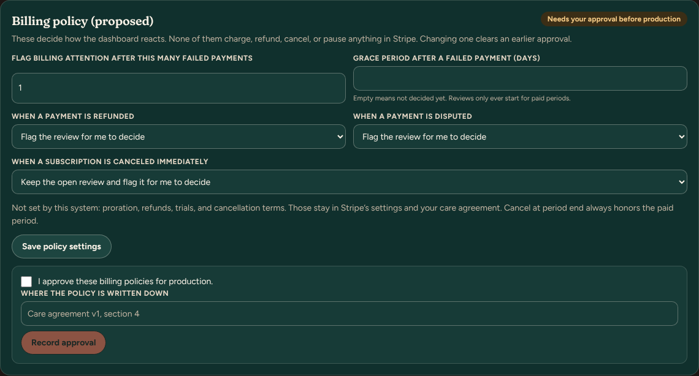

**Demo:**
- Renewal, failed payment, and cancellation come from Stripe events, so they can’t be triggered in the demo yet.
- The demo website Lakeside Dental shows an active simulated subscription.

## Less frequent tasks

- **Pause or end care:** on the website’s page, **Pause reviews** / **Resume reviews**, or **End care for this website** (reports are kept).
- **Change pages or checklist:** **Website settings**, **Save changes**, then confirm the setup again.
- **Move a due date:** in the review, **Runs, due date, and history**, then **Change due date**.
- **Retry a failed email to you:** Overview, **Needs your attention**, **Retry now**.
- **A send that never finished:** check the Resend log first, then **Mark not sent** and send again.
- **Review an older agreement:** Overview flag **Agreement predates flexible plan time**, then **Review**. Fill in how they accepted the current terms and press **Mark agreement reviewed**.
- **Add or change a preset:** **Task catalog**. Editing minutes makes it proposed again until you **Confirm minutes**.

## Troubleshooting

| What you see | What it means | What to do |
| --- | --- | --- |
| **Confirm setup** says the address is “private or reserved” | The address resolves to a private network, or it isn’t public. | Check the address and approved domains. Use **Check**. |
| Review stuck on **Waiting for setup confirmation** | A paid period arrived before you confirmed the setup. | Confirm the setup on the website’s page. |
| **Check failed: retry needed** | The checker couldn’t finish after its retries. | **Run the check again**; read the error under **Runs, due date, and history**. |
| **Quick add work** is greyed out | The client’s care terms aren’t current. | Record the terms (setup confirmation or **Mark agreement reviewed**). |
| Plan time says **No paid billing period yet** | There’s no paid period for this website. | Wait for the first payment, or add a paid period by hand. |
| “needs X standard minutes but only Y are available” | Recording would go past the allowance. | Create an estimate for the larger work. |
| **Mark ready for review** is greyed out | Something required is missing. | Fix each item listed under **Before this can be marked ready**. |
| **Send Report** is greyed out | The typed address doesn’t match, or client emails are switched off here. | Type the exact recipient address. In preview, client emails are limited to the test allowlist (simulated in the demo). |
| Delivery says **Not confirmed** | Resend’s delivery webhook isn’t set up. | Normal. Check the Resend dashboard if you need proof of delivery. |
| **Billing attention** above 0 | A payment failed, or a refund or dispute arrived. | Handle it in Stripe, then **Mark billing reviewed**. |
| Demo shows an error | The demo session’s data is odd, or the server was idle. | Wait a few seconds and retry, or **Reset demo**. |

## Labels and statuses that could confuse

- **Next review due “Not set” on the Websites table, while the queue shows due dates.** This was a bug, not two different meanings. The column read a stored date that was written only when a period was created. The demo’s sample websites didn’t have it, and it also went stale after a report was sent. It is now taken from the earliest open review, the same one the queue shows. Blank cells now say **After setup and first payment** or **Waits for the next paid period**.
- **“No subscription yet” for clients you bill by hand.** That was the Stripe state, which looked like the client hadn’t paid. Websites with paid periods added by hand now show **Billed outside Stripe**.
- **Care terms were stamped as accepted on saving.** Fixed: acceptance is now recorded when you confirm the setup, with your own note of how the client accepted.
- **Three billing words.**
  - **Period paid** (in a review’s header): this period is paid.
  - **Paid, active** (on the website): the Stripe subscription is in good standing.
  - **Paid** or **Billed outside Stripe** (in the queue): how the period was paid.
  - They don’t say whether the review is done; the work status does.
- **Agreed monthly price versus the Stripe charge.** Reports show the agreed price, but Stripe charges the plan’s price. They differ for any client with a custom price. That needs a decision: a separate Stripe price per custom price, or billing those clients by hand.
- **“(no Stripe price set)” beside a plan.** The Stripe price ID for that plan isn’t configured, so checkout would fail. The demo hides this because checkout there is simulated.
- **“Accepted by provider” is not “Delivered”.** Delivery is confirmed only with Resend’s webhook.
- **Billing policy “proposed”.** These settings flag and remind; they don’t enforce anything yet.

Fixed while writing this guide: confirming a real website’s setup failed for every public IPv4 address (the private address check matched IPv4 against an IPv6 rule). Every new enrollment would have been refused at **Confirm setup and enable reviews**.
